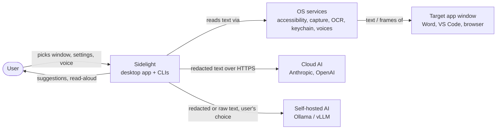
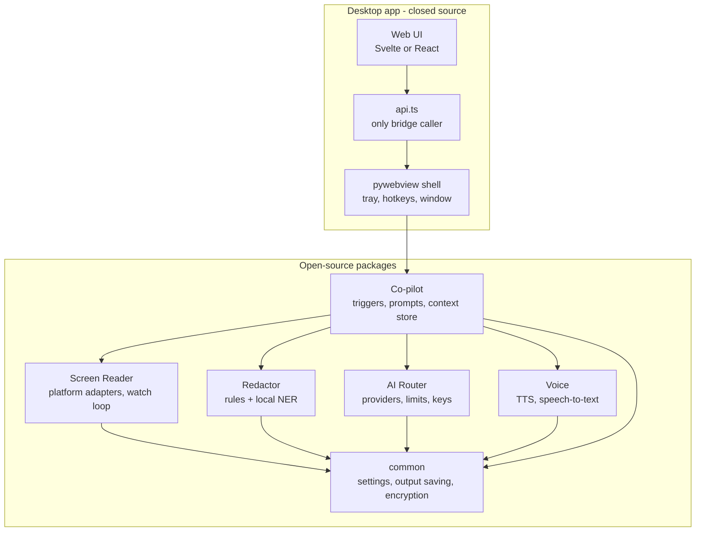
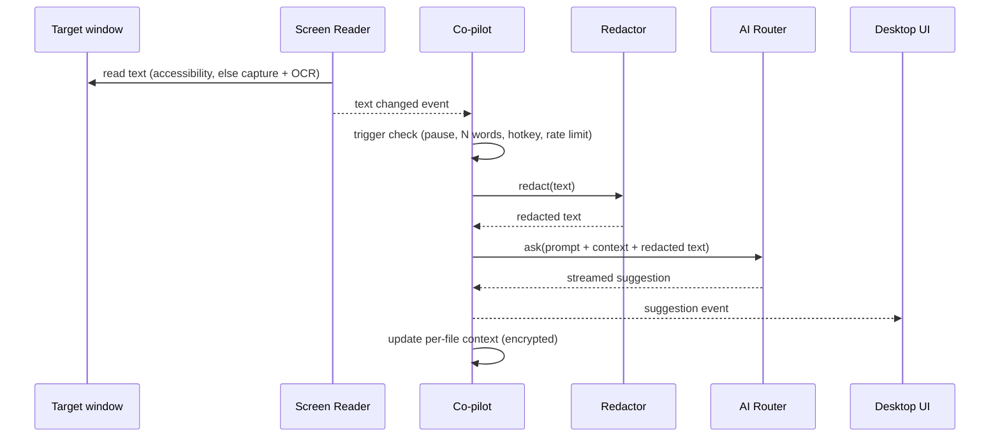

# Architecture: Sidelight

| Field | Value |
| --- | --- |
| Status | Draft |
| Version | 0.1 |
| Owner | Dominic |
| Last updated | 2026-11-04 |
| Structure | Based on arc42, with C4 model diagrams (Mermaid) |

## 1. Goals and quality priorities

| Priority | Quality goal | Scenario |
| --- | --- | --- |
| 1 | Privacy | Raw screen data never leaves the capture process; only redacted text goes to a backend the user chose |
| 2 | Modularity | Each sub-project installs, runs and releases on its own |
| 3 | Efficiency | Watching a static window uses under 3% CPU |
| 4 | Portability | Adding macOS means writing adapters, not changing core logic |
| 5 | Customizability | Users control triggers, prompts, profiles, storage and look |

## 2. Constraints

- Python 3.12+ for all backend code (ADR-0003).
- pywebview desktop shell with a web frontend (ADR-0002).
- Windows first, macOS second.
- Solo developer: favor proven libraries over custom infrastructure.

## 3. System context (C4 level 1)

## 4. Containers (C4 level 2)

| Container | Responsibility | Key technologies |
| --- | --- | --- |
| Screen Reader | Window listing, text extraction, change events | UI Automation, Windows Graphics Capture, Windows.Media.Ocr; later AX, ScreenCaptureKit, Vision; Tesseract fallback |
| Redactor | Detect and mask sensitive data | Rules, Presidio, spaCy or GLiNER |
| AI Router | Talk to AI backends with limits | Anthropic and OpenAI SDKs, Ollama REST, keyring |
| Voice | Read-aloud and dictation | OS voices (Windows SAPI / WinRT speech, macOS AVSpeechSynthesizer), faster-whisper |
| Co-pilot | Orchestrate the loop and context | asyncio, SQLite with encryption (approach to be decided in an ADR: SQLCipher or app-level encryption with `cryptography`) |
| common | Shared settings and output saving | platformdirs, keyring, cryptography |
| Agent Bridge (proposed) | Read-only, redacted window text for other AI agents over MCP (ADR-0011) | `mcp` Python SDK, stdio transport |
| Desktop app | UI and OS integration | pywebview; tray and global hotkeys through thin OS wrappers (pywin32/ctypes on Windows, PyObjC on macOS), avoiding LGPL libraries |

## 5. Runtime view: one suggestion

## 6. Process model

- The desktop app runs one main Python process. pywebview hosts the UI and exposes a Python API object to JavaScript through the web view's in-process bridge, not over HTTP. If the UI is loaded from local files by relative path, pywebview also starts a localhost server for those static files only; prefer loading the bundled UI so no port is opened, or enable pywebview's `ssl` option.
- Screen Reader capture and OCR run in a child process so native-library crashes or leaks cannot take down the UI; it sends only text back over a pipe (NFR-09).
- CLIs run each package in a single process.

## 7. Data view

| Data | Where it lives | Lifetime | Leaves device? |
| --- | --- | --- | --- |
| Captured frames | Child process memory only | Discarded after OCR | Never |
| Extracted text | Memory | Session, unless saving on | Only redacted, only to chosen backend |
| Transcripts, reports, history | User-chosen folder | User retention setting | Never |
| Per-file context | Encrypted SQLite in app data folder | Until user deletes or retention | Summaries sent with prompts, redacted |
| API keys | OS credential store | Until user removes | Only to their own provider |
| Settings, profiles | JSON in app data folder | Permanent | Never |
| Downloaded ML models | App data folder | Until user removes | Downloaded only when the user starts it |

Details: [Privacy and data handling](../security/privacy.md).

## 8. Cross-cutting concepts

- **Platform adapters:** `WindowLister`, `TextSource`, `FrameCapture`, `OcrEngine` interfaces with one implementation per OS (NFR-11).
- **Configuration:** one settings file per user, schema-validated (pydantic), with per-profile overrides.
- **Errors:** each package raises its own typed errors; the app shows plain-language messages.
- **Logging:** local rotating logs, no user content at default level.
- **Prompt safety:** captured text is placed in clearly delimited data blocks; the system prompt tells the model to treat it as content, not instructions (CP-09).

## 9. Architecture decisions

See [ADR index](adr/README.md).

## 10. Risks and technical debt

| Risk | Mitigation |
| --- | --- |
| Inconsistent accessibility text across apps | OCR fallback; compatibility list; per-app overrides |
| macOS permission attribution for bundled Python | Sign everything inside one app bundle; test early in phase 7 |
| ML model size for Redactor | Small spaCy model by default; larger models optional download |
| pywebview limits (tray, hotkeys, updates) | Extra libraries; shell isolated behind api.ts so it can be swapped |
