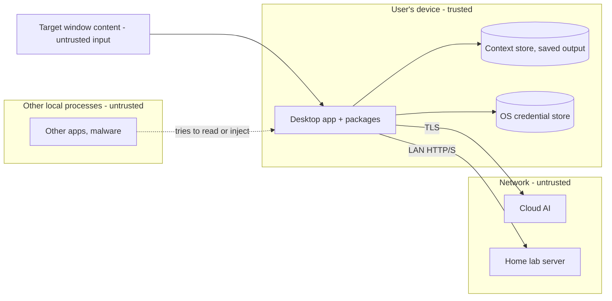

# Threat Model: Sidelight

| Field | Value |
| --- | --- |
| Status | Draft |
| Version | 0.1 |
| Owner | Dominic |
| Last updated | 2026-11-04 |
| Method | STRIDE per element, reviewed each release |

## 1. Scope

Desktop app and all open packages on Windows and macOS, including connections to AI backends. Out of scope: security of the user's AI provider and of a self-hosted server itself.

## 2. Assets

| Asset | Why it matters |
| --- | --- |
| Screen content | May include personal data, credentials, confidential work |
| API keys | Can be abused to run up the user's bill |
| Per-file context and saved output | Long-lived record of the user's work |
| Audio from dictation | Personal and potentially sensitive |
| The user's trust | The product's core promise is privacy |

## 3. Trust boundaries

## 4. Threats and mitigations (STRIDE)

| ID | Category | Threat | Mitigation | Req |
| --- | --- | --- | --- | --- |
| T-01 | Information disclosure | Overlapping windows (chats, notifications) get captured | Window-scoped capture APIs only | SR-03 |
| T-02 | Information disclosure | Secrets or personal data sent to a cloud provider | Redactor before every cloud call; app blocklist; local backend option | CP-01, CP-02 |
| T-03 | Information disclosure | Screenshots written to disk or leaked from memory | Frames stay in a child process, never written; buffers released right after OCR (Python cannot guarantee memory is zeroed) | SR-07 |
| T-04 | Information disclosure | Saved output or context read by another user or malware | Off by default; optional encryption; app data folder permissions | NFR-06 |
| T-05 | Spoofing / tampering | Another local process connects to the backend | No API port: pywebview in-process bridge; bundled UI loaded without the localhost file server, or with its `ssl` option | ADR-0002 |
| T-06 | Tampering | Prompt injection: on-screen text tells the AI to misbehave | Captured text delimited as data; app only suggests, never acts; no tools given to the model | CP-09 |
| T-07 | Information disclosure | API keys stolen from config files | Keys only in OS credential store, never in files or logs | AR-02 |
| T-08 | Elevation / tampering | Malicious update or tampered installer | Signed and notarized builds; update files verified by signature | NFR-07 |
| T-09 | Tampering | Vulnerable or hijacked dependency | Pinned lockfile, vulnerability scanning, Dependabot | NFR-08 |
| T-10 | Denial of service / cost | Runaway loop makes thousands of API calls | Rate limit and daily spend cap in AI Router | AR-03, AR-04 |
| T-11 | Information disclosure | Home lab traffic sniffed on the LAN | Warn when endpoint is plain HTTP; support HTTPS and auth headers | AR-01 |
| T-12 | Repudiation / misuse | Tool used to monitor someone else | Visible capture indicator; one window at a time; no remote control; consent notes in docs | UI-02 |
| T-13 | Information disclosure | Logs contain screen text | No user content in logs at default level | Architecture §8 |
| T-14 | Information disclosure | Dictation audio leaves the device | Local speech-to-text only | VO-03 |
| T-15 | Information disclosure | Password fields read through the accessibility API | Skip elements marked as password fields | SR-13 |
| T-16 | Tampering | Tampered ML model downloaded for Redactor or Voice | Downloads only when the user starts them; pinned model versions and checksums | NFR-04, NFR-08 |
| T-17 | Information disclosure | An agent connected through the bridge sends screen text somewhere the user didn't expect | Always redacted; user approves the window; read-only; indicator and read log; docs state the bridge is the privacy boundary | AG-03, AG-04, AG-06 |
| T-18 | Tampering | Screen text injects instructions into a connected agent that has its own tools | Results marked as untrusted content; read-only bridge; warn in setup docs | AG-02, AG-05 |

## 5. Residual risks

- OS-level malware with screen or memory access can see what the user sees; out of our control.
- Redaction is probabilistic; some sensitive data can slip through. Users handling regulated data should use a local backend.
- Cloud providers' own retention policies apply to anything sent to them; the docs link each provider's policy.

## 6. Review

Re-run this model at each minor release and whenever a new data flow, backend or platform is added.
